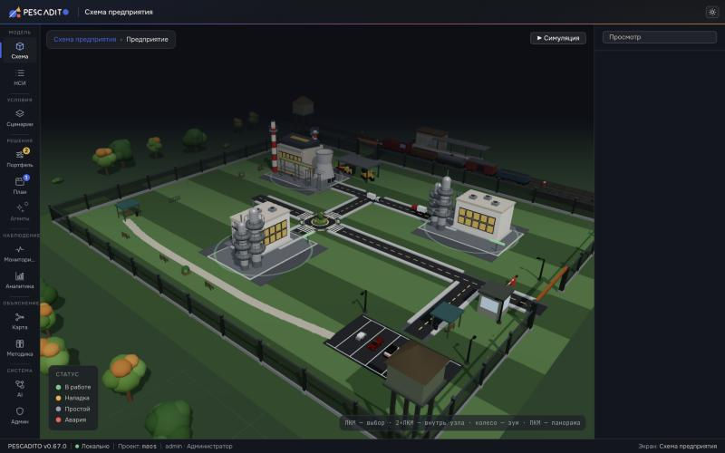

# MAOS

[English](README.md) · **Русский**

MAOS — кодовое имя проекта; оно используется в коде и документации. Веб-интерфейс называется
**PESCADITO**, а Python-слой в [`rl/`](rl/README.md) (макро-генератор, sidecar CP-SAT, обучение с
подкреплением) имеет кодовое имя **AUREUS**.

MAOS — система планирования и **оптимизации производства** под неопределённостью. В основе —
**двухстадийная стохастическая модель**: Стадия 1 решает, **как** выполнить программу (расписание
операций), Стадия 2 — **что** производить (портфель продукции, устойчивый к ценовому риску). Демо-данные
описывают металлургический комбинат полного цикла. Все расчёты выполняет локальный **C++17-бэкенд** по
базе SQLite; фронтенд — приложение на React/TypeScript с 3D-схемой предприятия. Интерфейс и документация —
на русском языке.



*Экран «Схема предприятия». Снимок сделан на версии v0.67.0.*

Текущая версия задаётся в [`package.json`](package.json) и показывается в статус-баре и на окне входа;
бэкенд сообщает свою версию в `GET /api/health`.

## Главная идея — две стадии, обе под неопределённостью

```
СТАДИЯ 1 — КАК произвести (исполнение):
  программа + граф оборудования + техкарты + рабочие + календари
  → поиск хорошего ПОРЯДКА операций (симуляция-оценщик, диспетчерские правила, ГА)
  → диаграмма Ганта, загрузка оборудования, планы рабочих, узкие места, простои
  → длительности операций ТЯЖЕЛОХВОСТНЫЕ (Монте-Карло) ⇒ риск срыва срока

СТАДИЯ 2 — ЧТО производить (портфель):
  себестоимость и срок из Стадии 1 + стохастические коррелированные ЦЕНЫ сбыта
  → устойчивый ПОРТФЕЛЬ продукции (CVaR / худший случай / mean-variance / min-regret)
  → диверсификация под ценовой риск («не ставить всё на одно изделие»)

СВЯЗЬ: портфель Стадии 2 становится программой Стадии 1.
```

Цель — найти решение, **самое устойчивое** к внешним условиям, а не самое прибыльное в среднем.
Полная модель: [docs/SCHEDULING.md](docs/SCHEDULING.md) (Стадия 1),
[docs/OPTIMIZATION.md](docs/OPTIMIZATION.md) (Стадия 2), [docs/CONCEPT.md](docs/CONCEPT.md),
[docs/METHODOLOGY-V2.md](docs/METHODOLOGY-V2.md).

## Внешние условия и прогнозы

- **Цены** изделий и сырья и **ключевая ставка** прогнозируются по истории (`ts_data`, `macro_ts`)
  единым движком (`POST /api/forecast`). Шаги: тренд как остаток EMD, адаптивные гармоники и
  распределение остатка, выбранное по AIC из нормального, Лапласа, t-Стьюдента и α-stable. Затем
  Монте-Карло строит помесячный веер P10/P50/P90. Взаимосвязь цен берётся из исторических корреляций
  (МГК/PCA, однофакторная модель).
- **Макросценарии** (ключевая ставка, курс USD/RUB, инфляция) строит генератор, обученный на публичных
  рядах Банка России, в [`rl/macro`](rl/README.md). Конвейер: ridge-VAR(1), затем SVD остатков, затем
  гауссов HMM с 1–3 режимами, затем блочная выборка остатков по режиму. `MacroSampler` бэкенда читает
  сохранённые параметры (`rl/macro/params/macro_params.json`) и побитово воспроизводит пути
  Python-сэмплера.

## Что реализовано

**Данные и модель**
- Реестры НСИ, связанные по ID внешними ключами: типы оборудования, оборудование, изделия, техкарты,
  операции, рабочие. Себестоимость и мощности считаются по производственной цепочке (BOM,
  `operation_inputs`).
- 3D-схема предприятия хранится в БД (`GET /api/scheme`) и имеет три уровня: мировая карта, площадка,
  цех.
- Каждый проект — отдельный файл SQLite; его выбирают или создают на окне входа.
- Паспорт параметров: у каждого параметра модели есть статус и источник (`param_passport`,
  `fin_params`).

**Стадия 1 — расписание**
- Списочное планирование FJSP (гибкий job-shop). Программа разворачивается в операции и упорядочивается
  диспетчерским правилом: EDD, SPT, CR, MWKR, MS, FIFO или LPT. Можно задать и свою взвешенную
  эвристику.
- Длительности операций тяжелохвостные (Монте-Карло). Рабочие календари, MRP-потребность в материалах,
  диаграмма Ганта, очереди и загрузка, узкие места, KPI (makespan, tardiness, OTD).
- Улучшение генетическим алгоритмом: random-key GA по приоритетам диспетчеризации.
- Необязательное точное правило **CP-SAT** через Python-sidecar `rl/cpsat_service.py` (OR-Tools). Оно
  доступно через API бэкенда (`POST /api/schedule` с `"rule": "CP-SAT"`); мастер плана его не
  предлагает.
- Необязательное правило **RL**: политика ONNX, исполняемая ONNX Runtime. Обученной политики в
  репозитории нет. Её обучают и экспортируют средствами `rl/` (см. [rl/README.md](rl/README.md)); до
  этого правило отвечает понятной ошибкой.
- Симуляция плана с воспроизведением на 3D-схеме. Наблюдённые длительности можно после подтверждения
  записать в нормы.

**Стадия 2 — портфель**
- Устойчивый портфель выбирается методом Монте-Карло по коррелированным ценам. Критерии: CVaR,
  худший случай, mean-variance и min-regret. Модель спроса добавляет ёмкость рынка, эластичность цены и
  объём конкурентов.
- Точная ЛП-модель для CVaR и худшего случая (Рокафеллар–Урясев) решается **HiGHS** на тех же
  сценариях. Она даёт двойственные оценки; экран также показывает проверку вне выборки и Парето-фронт.
- Выбранный портфель можно передать в Стадию 1 как план.

**Финансы**
- Касса: недельный денежный водопад по каждому сценарию и CVaR-ЛП с денежными средствами, долгом и
  нижней границей ликвидности (HiGHS). В результат входит кривая цены ликвидности; он показан в разделе
  «Касса» плана.
- Инвестпроекты: докупка оборудования (по умолчанию — для узкого места) оценивается парными прогонами
  симуляции на общих случайных числах. Результаты: E[NPV] с доверительным интервалом, CVaR NPV,
  вероятность кассового разрыва и срок окупаемости.

**Агенты (RL/MARL)**
- Дискретно-событийная среда на C++ (`SimEnv`) доступна из Python через nanobind. Стенд RL в `rl/`
  использует среды Gymnasium, обучение MaskablePPO, бенчмарки и экспорт в ONNX.
- Экран «Агенты» показывает статус агента, вердикт гейта, доказательства по бенчмаркам и полномочия
  агента.

**Объяснение**
- Карта методологии: граф из 8 блоков с живыми состояниями и паспортом параметров у каждого узла.
- Текст методики («Методика»).
- [MENTAT](#mentat--объяснения-на-llm): объяснение рассчитанных результатов локальной языковой моделью.

**Система**
- Вход через реестр пользователей с ролями и правами (RBAC). После 5 неудачных попыток учётная запись
  блокируется на 5 минут. Журнал аудита фиксирует, кто, что и когда менял.
- Миграции БД ведутся по `PRAGMA user_version` (сейчас до v21). Они идемпотентны и сохраняют
  существующие данные.

## Экраны

| Экран | Что делает |
|---|---|
| «Схема предприятия» | Стартовый экран. 2D-карта мира с площадками (MapLibre) и 3D-уровни площадки и цеха, построенные по БД. Три режима: просмотр, редактирование (изменения сохраняются в справочники, с отменой) и симуляция (воспроизводит план на сцене) |
| «Справочники» | Шесть реестров: типы оборудования, оборудование, изделия, техкарты, операции, рабочие. Есть редактор техкарт |
| «Сценарии» | Список и редактор сценариев (условия, распределения, прогноз цен). Есть галерея пресетов (прогноз, исторические эпизоды, стресс-тесты), настройки макро-генератора и сравнение до 5 сценариев рядом |
| «Портфель» (Стадия 2) | Устойчивый выбор того, что выпускать: эвристика против точной ЛП с двойственными оценками, проверка вне выборки, Парето-фронт и загрузка оборудования. Передаёт результат в «План» |
| «План» (Стадия 1) | История прогонов и мастер из шести шагов: программа, условия, распределения, ограничения, цель и риск, запуск. Результаты: KPI, узкое место, ходы агента, диаграмма Ганта (перетаскивание закрепляет операцию), очереди и загрузка, таблицы, касса |
| «Агенты» | Вердикт по RL-агенту, доказательства по бенчмаркам, полномочия агента и устройство агентного слоя |
| «Мониторинг» | Что изменилось во внешних условиях и ценах относительно плана: сигналы, веера ключевой ставки, инфляции и курса, панель «Что если…» |
| «Аналитика» | KPI выбранного построения плана, узкие места, инвестпроекты и материальные потоки (список, тепловая карта, Sankey) |
| «Карта методологии» | Граф из 8 блоков методологии с живыми состояниями и панелью узла |
| «Методика» | Развёрнутое описание методов с формулами и источниками |
| «AI-воркфлоу» | Редактор узлов для черновиков сценариев диалога MENTAT. Черновики хранятся в localStorage браузера и экспортируются в JSON; бэкенд их не исполняет |
| «Администрирование» | Журнал аудита, пользователи и матрица «роль × право» |

Панель MENTAT открывается с любого экрана кнопкой в верхней панели или сочетанием Cmd/Ctrl+J.

## MENTAT — объяснения на LLM

MENTAT отвечает на вопросы «почему так» по уже выполненному расчёту: портфелю, плану, кассе,
результату RL или инвестпроекту. Он собирает контекст из графа расчёта и отправляет промпт языковой
модели. Затем он сверяет каждое число ответа с узлом графа, на который ссылается ответ, и помечает
каждое утверждение как сверенное, несовпавшее или без опоры. MENTAT не прогнозирует и не
оптимизирует. Бэкенд никогда не генерирует ответы сам: если модель не настроена, `POST /api/mentat/ask`
возвращает 503, а панель сообщает, что локальная модель не подключена.

- Нужен сервер модели с **OpenAI-совместимым API** (vLLM, llama.cpp `llama-server`, LM Studio) или
  **Ollama**, доступный по **обычному HTTP**. Адреса `https://` отклоняются; TLS — через обратный
  прокси вне MAOS.
- Модель настраивается в MENTAT → «Подключение» (сохраняется в настройках проекта) или переменными
  окружения бэкенда, которые имеют приоритет: `MAOS_LLM_URL`, `MAOS_LLM_MODEL`, `MAOS_LLM_FLAVOUR`
  (`openai` или `ollama`) и `MAOS_LLM_API_KEY` (только из окружения, нигде не хранится).
- По умолчанию принимаются только loopback-адреса. Любой другой хост нужно перечислить в
  `MAOS_LLM_ALLOWED_HOSTS` (через запятую); хост самой `MAOS_LLM_URL` разрешён всегда.

```bash
cd backend/build
MAOS_LLM_URL=http://127.0.0.1:11434 MAOS_LLM_FLAVOUR=ollama MAOS_LLM_MODEL=qwen2.5:14b-instruct ./maos_server maos.db
```

Подробности (формат контекста, каталог промптов, проверка ответов) — в
[docs/MENTAT.md](docs/MENTAT.md).

## Сетевой доступ

Бэкенд слушает только `127.0.0.1:8080`, фронтенд обращается к нему через прокси Vite. Всё работает
локально, за такими исключениями:

- **Во время работы** 2D-карта мира (верхний уровень схемы предприятия) загружает стили и тайлы
  подложки CARTO с `basemaps.cartocdn.com`. Ещё она запрашивает маршруты дорог у публичного сервера
  OSRM `router.project-osrm.org`. Без интернета эти запросы не проходят, и маршруты рисуются прямыми
  линиями.
- MENTAT отправляет запросы только на настроенный вами сервер модели.
- **При сборке и установке** CMake скачивает зависимости C++ (см. ниже), а `pnpm install` — пакеты npm.
  `python -m rl.macro.data` скачивает ряды Банка России, но только если вы его запускаете.

## Требования

- **Node.js 18+** (рекомендуется 20 LTS) и **pnpm**. Lock-файл — `pnpm-lock.yaml`.
- **Компилятор C++17, CMake 3.16+ и SQLite3** (библиотека и заголовки). Для первой конфигурации CMake
  нужны также **git и доступ к сети**: FetchContent скачивает
  - cpp-httplib v0.16.3 и nlohmann/json v3.11.3 (header-only);
  - HiGHS v1.15.1 — собирается из исходников как статическая библиотека (точные ЛП);
  - GoogleTest v1.15.2 — если тесты включены (`MAOS_BUILD_TESTS`, по умолчанию ON);
  - ONNX Runtime 1.20.1 — готовый архив для macOS arm64, если `MAOS_WITH_ONNX` включён. По умолчанию
    он включён только на macOS arm64; на других платформах выключен, и правило RL недоступно.
- **Необязательно: Python 3** с [`rl/requirements.txt`](rl/requirements.txt) — для sidecar CP-SAT,
  переобучения макро-генератора и стенда RL.

## Установка и запуск

Нужны два процесса: C++-бэкенд и веб-фронтенд.

### 1. Бэкенд (C++)

```bash
cd backend && mkdir -p build && cd build
cmake .. -DCMAKE_BUILD_TYPE=Release     # -DMAOS_BUILD_TESTS=OFF — без GoogleTest
cmake --build . -j
./maos_server maos.db                   # http://127.0.0.1:8080
```

Запускайте сервер **из `backend/build`**. Он читает `schema.sql` из рабочей папки (CMake копирует его
рядом с бинарником), поэтому при запуске из другой папки сервер падает с ошибкой
`schema.sql not found`. Пути к базам задаются относительно рабочей папки, и список проектов на окне
входа показывает файлы `*.db` из неё.

При запуске на пустой базе сервер **автоматически засевает демо-данные**: металлургический комбинат с
цехами и оборудованием, изделия, техкарты, операции, рабочих, заказы, сценарии, историю цен и ключевой
ставки. Миграции идемпотентны и сохраняют существующие данные.

Необязательные настройки бэкенда (переменные окружения):

| Переменная | Назначение |
|---|---|
| `MAOS_LLM_*` | Подключение модели MENTAT (см. [MENTAT](#mentat--объяснения-на-llm)) |
| `MAOS_CPSAT_URL` | Адрес sidecar CP-SAT, по умолчанию `http://127.0.0.1:8091` |
| `MAOS_RL_POLICY_DIR` | Папка с `l0_policy.onnx`. Если не задана, сервер ищет в `rl/results`, `../rl/results`, `../../rl/results`, `backend/data` и `data` относительно рабочей папки |
| `MAOS_MACRO_PARAMS` | Путь к `macro_params.json`. Если не задан, сервер находит `rl/macro/params/macro_params.json` относительно рабочей папки |

Для правила CP-SAT запустите sidecar из корня репозитория:

```bash
python3 -m venv rl/.venv
rl/.venv/bin/pip install -r rl/requirements.txt
rl/.venv/bin/python -m rl.cpsat_service   # 127.0.0.1:8091
```

### 2. Фронтенд (веб)

```bash
pnpm install
pnpm dev                     # http://localhost:5173 (проксирует /api на 127.0.0.1:8080)
```

Откройте **http://localhost:5173**.

### 3. Вход: аккаунт и проект

На окне входа три поля:

| Поле | Значение |
|---|---|
| «Проект (производство)» | какую **базу** открыть (см. ниже) |
| «Логин» | `admin` |
| «Пароль» | `maos2025` |

> [!WARNING]
> `admin` / `maos2025` — **демо-учётные данные**, они засеваются в каждую новую базу. Смените их в
> «Администрировании» до любого реального использования. Встроенный вход рассчитан только на
> локальную работу: пароли хранятся как хеши FNV-1a с солью, а не функцией хеширования паролей, и
> сервер слушает только `127.0.0.1`.

У учётной записи `admin` роль «Администратор». В «Администрировании» можно сбрасывать
пароли и управлять пользователями и ролями. После 5 неудачных попыток вход блокируется на 5 минут.

**Проекты — это отдельные базы данных.** Каждое производство — свой файл SQLite (`*.db`) в рабочей папке
бэкенда (`backend/build/`). В списке «Проект»:

- **существующие базы** — все файлы `*.db` из этой папки (например, `maos.db`);
- **«+ Новый проект…»** — создаёт **новую базу** с демо-данными, `<название>.db`.

Выбранный проект открывается при входе, поэтому переключаться между производствами можно с окна входа,
не перезапуская сервер. Аргумент `./maos_server <файл>.db` задаёт лишь базу, открытую при старте.

> Если после действия приложение возвращает на окно входа, истекла сессия. Сессии хранятся в памяти
> сервера и живут 12 часов, поэтому перезапуск бэкенда тоже их завершает. Просто войдите заново.

## Команды

| Команда | Назначение |
|---|---|
| `pnpm dev` | Дев-сервер фронтенда с HMR |
| `pnpm build` | Проверка типов + продакшн-сборка в `dist/` |
| `pnpm typecheck` | Только проверка типов |
| `pnpm test` | Юнит-тесты фронтенда (Vitest) |
| `pnpm preview` | Локальный просмотр продакшн-сборки |
| `cmake --build backend/build -j` | Сборка бэкенда |
| `cd backend/build && ./maos_server maos.db` | Запуск бэкенда |
| `cd backend/build && ctest --output-on-failure` | Тесты C++ (GoogleTest; можно запустить и `./maos_tests` напрямую) |
| `rl/.venv/bin/pytest rl/macro` | Python-тесты макро-генератора |
| `rl/.venv/bin/pytest rl/` | Все Python-тесты. Тестам `rl/env` нужен нативный модуль `maos_env`, собранный с `-DMAOS_BUILD_PYENV=ON` (см. [rl/README.md](rl/README.md)) |

## Технологический стек

- **Фронтенд:** React 18, TypeScript и Vite 5. 3D-схема построена на three.js с @react-three/fiber, drei
  и postprocessing, 2D-карта мира — на MapLibre GL. Тесты — Vitest. Оформление — собственные
  дизайн-токены с плотностью в духе Blueprint (`src/styles/tokens.css`), тёмная и светлая темы;
  библиотеки UI-компонентов в зависимостях нет.
- **Бэкенд:** C++17 с cpp-httplib (HTTP на `127.0.0.1:8080`), SQLite и nlohmann/json. ЛП решает HiGHS;
  ONNX Runtime необязателен. Тесты — GoogleTest.
- **Python-слой (`rl/`, AUREUS):** макро-генератор (NumPy, SciPy, pandas, hmmlearn), sidecar CP-SAT на
  OR-Tools и стенд RL: Gymnasium и Stable-Baselines3 (MaskablePPO) поверх C++ `SimEnv` через nanobind,
  с экспортом в ONNX.

## Структура проекта

```
backend/                     C++-бэкенд (ядро + HTTP API)
├── src/
│   ├── main.cpp             HTTP-сервер, эндпоинты, миграции, демо-посев, движок прогноза
│   ├── Database.{h,cpp}     обёртка SQLite
│   ├── Scheduler.*          Стадия 1: FJSP-расписание (тяжёлый хвост длительностей)
│   ├── GaImprover.*         Стадия 1: улучшение генетическим алгоритмом
│   ├── CpSatRule.*          клиент sidecar CP-SAT
│   ├── RlRule.*             правило RL (политика ONNX)
│   ├── SimEnv*.cpp          дискретно-событийная среда для агентов (pyenv.cpp: модуль nanobind)
│   ├── Optimizer.*          Стадия 2: устойчивый портфель
│   ├── ExactCvar.*          точная ЛП CVaR / худшего случая (HiGHS)
│   ├── Cash*.*              денежный водопад и ЛП кассы
│   ├── Invest*.*            оценка инвестпроектов
│   ├── MacroSampler.*       сэмплер обученного макро-генератора
│   ├── Passport.*           паспорт параметров
│   ├── Mentat*.*            шлюз MENTAT к локальной LLM
│   └── schema.sql           схема БД
├── tests/                   набор тестов GoogleTest (maos_tests)
└── CMakeLists.txt
src/                         фронтенд (React + TS)
├── shell/                   оболочка: рельса навигации, верхняя панель, статус-бар, реестр экранов (screens.tsx)
├── lib/api.ts               типизированный API-клиент
├── features/                папка на экран или функцию: plant-scene, nsi, scenarios,
│                            optimization, plan, agents, forecast («Мониторинг»), analytics,
│                            method-map, methodology, workflow-builder, admin, auth,
│                            explain (MENTAT), finance, passport
├── explain/                 определения показателей, подписи, форматирование чисел
├── diagrams/                поясняющие схемы для методики
├── ui/                      UI-кит и компоненты графиков
└── styles/                  дизайн-токены
rl/                          Python-слой (AUREUS): макро-генератор, sidecar CP-SAT, стенд RL
docs/                        документация (на русском)
```

## Документация

- [docs/CONCEPT.md](docs/CONCEPT.md) — фундаментальная модель (как всё устроено).
- [docs/ARCHITECTURE.md](docs/ARCHITECTURE.md) — архитектурные решения (ADR).
- [docs/SCHEDULING.md](docs/SCHEDULING.md) — Стадия 1 (расписание исполнения).
- [docs/OPTIMIZATION.md](docs/OPTIMIZATION.md) — Стадия 2 (устойчивый портфель).
- [docs/METHODOLOGY-V2.md](docs/METHODOLOGY-V2.md) — методология V2 (финансы, RL, игры).
- [docs/ANALYTICS.md](docs/ANALYTICS.md) — требования к разделу «Аналитика».
- [docs/MENTAT.md](docs/MENTAT.md) — MENTAT, объяснения на LLM.
- [docs/UX-V2.md](docs/UX-V2.md) — потоки принятия решений и «Карта методологии».
- [docs/RL-METHODOLOGY-PROPOSAL.md](docs/RL-METHODOLOGY-PROPOSAL.md) — агентный слой (RL/MARL).
- [docs/REQUIREMENTS.md](docs/REQUIREMENTS.md) — сущности, БД, прослеживаемость требований.
- [docs/ROADMAP.md](docs/ROADMAP.md) — исходный план стадий. Большинство статусов в нём относятся
  примерно к v0.47, актуальное состояние — в документах выше.
- [rl/README.md](rl/README.md) — Python-слой (макро-генератор, sidecar CP-SAT, стенд RL).

## Лицензия

См. [LICENSE](LICENSE).
